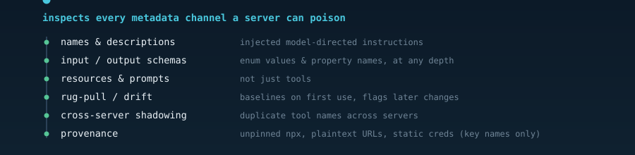

<p align="center">
  
</p>

<p align="center">
  
  
  
  
</p>

---

## What it is

An MCP server advertises **tools, resources, and prompts**, each carrying a `name`, a `description`, and (for tools) an `inputSchema`/`outputSchema` whose fields also hold text. A client loads that **metadata into the model's context at session start — before anything is ever called.** A malicious server can therefore hide orders for the model inside that text ("**tool poisoning**"). Reviewing the server's *code* never catches it, because the payload lives in the metadata.

**mcp-auditor** reads that metadata and flags injection-shaped content in plain English. It only pattern-matches and reports — it **never follows, executes, or evaluates** any instruction it finds, and it **never prints secret values** (only key names).

> This is a different layer than config-guard: config-guard checks the repo-shipped `.mcp.json` *config* (what a server launches); mcp-auditor checks the *live tool metadata* a running server actually serves.

## What it inspects

<p align="center">
  
</p>

- **Injection** in names, descriptions, and — recursively — **every string in the schema** (property names, titles, nested descriptions, **enum values**).
- **Resources & prompts**, not just tools.
- **Rug-pull / drift** — baselines each server on first sight (trust-on-first-use) and flags any later change to its definitions.
- **Cross-server shadowing** — duplicate tool names across servers.
- **Provenance** — unpinned `npx -y`/`uvx`/`pipx`, `curl | sh`, non-HTTPS transport, and static credentials (reported by **key name only**).
- **Capability** notes — tools whose metadata implies exec / file-write / network, so you see a server's blast radius.
- Also flags **credential/exfil references** and **hidden/zero-width/bidi unicode**.

It is honest about limits: a footer lists what a *static* audit can't see (indirect injection via tool **results**, sandboxing, confused-deputy / token-passthrough).

## Install

mcp-auditor is a self-contained Claude Code **skill** — auto-discovered, **no configuration, no build step**. Clone it into your skills directory:

```bash
git clone https://github.com/Claude-Booster/mcp-auditor.git ~/.claude/skills/mcp-auditor
```

The engine lives inside the skill at [`scripts/mcp_auditor.py`](scripts/mcp_auditor.py). Then ask Claude *"audit this MCP server"* / *"is this MCP server safe?"* and the skill activates.

### Requirements

| Tool | Needed for | If missing |
|------|-----------|------------|
| **Python 3.10+** — standard library only, no `pip install` | Everything | The tool can't run |

No third-party packages. The only external dependency is a Python interpreter on your `PATH`.

## Usage

```bash
# read-only: scan a saved tools/list dump, nothing spawned
python scripts/mcp_auditor.py audit --file tools.json

# spawn a stdio MCP server and audit its live tools/resources/prompts
python scripts/mcp_auditor.py audit --stdio "npx -y some-mcp-server"

# audit every configured server (~/.claude.json + .mcp.json under PATH)
python scripts/mcp_auditor.py audit --config .

# after reviewing a flagged change, re-accept the new baseline
python scripts/mcp_auditor.py audit --config . --accept
```

`--stdio` and `--config` **launch the server** to read its live metadata (with a 15s timeout) — only run them on a server you intend to audit. `--file` is fully read-only. Exit code is `1` when any HIGH finding exists, else `0`.

## Reading the report

Leads with a one-line verdict + counts, then findings grouped by severity. Each finding names the server, the entity (tool/resource/prompt), the exact field (e.g. `inputSchema:properties.mode.enum.[1]`), a short matched snippet, and what the text would try to make the model do. Servers it couldn't reach are reported **"NOT audited — treat as NOT safe,"** never "clean."

## Where things live

| Thing | Location |
|-------|----------|
| The engine | `scripts/mcp_auditor.py` (inside this skill) |
| Tests | `scripts/test_mcp_auditor.py` |
| Rug-pull baseline | `~/.claude/mcp-auditor/baseline.json` (override with `MCP_AUDITOR_HOME`) |

## Safety

- The tool **only reads and pattern-matches** metadata — it never follows instructions found inside it, and treats all server output as inert JSON data.
- It **never prints `env`/`headers` values** — provenance findings show key names only.
- `--file` spawns nothing; `--stdio`/`--config` spawn the audited server with a hard timeout and always terminate it.

## Contributing

To *use* the skill you need nothing below. For changes, run the tests from the skill folder:

```bash
cd scripts && python -m unittest -v
```
